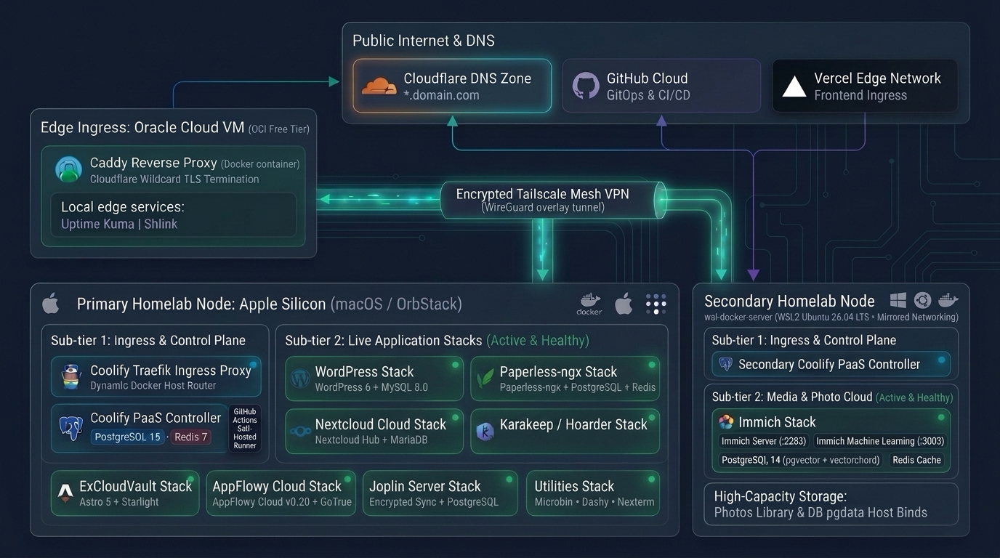

# Homelab

Modern self-hosted infrastructure and application platform orchestrated via **Coolify** across a multi-node topology: **Primary macOS Node** (OrbStack Docker Engine) and **Secondary Windows Host** (WSL2 Ubuntu Docker Engine) with automated **GitOps CI/CD** via GitHub Actions.

---

## Architecture Diagram



> Detailed technical specifications, network diagrams, and security models are documented in [**docs/ARCHITECTURE.md**](docs/ARCHITECTURE.md).

---

## Documentation Quick Links

- 📐 [**System Architecture (docs/ARCHITECTURE.md)**](docs/ARCHITECTURE.md): Deep-dive into Cloudflare DNS, OCI Caddy edge ingress, Tailscale mesh VPN, multi-node compute topology, WSL2 mirrored networking, and security isolation.
- 🚀 [**Deployment Runbook (docs/DEPLOYMENT.md)**](docs/DEPLOYMENT.md): Step-by-step setup guide for the GitHub Actions Self-Hosted Runner on Apple Silicon, Coolify GitOps configuration, WSL2 Docker Server setup, cutover, and emergency rollback.

---

## Directory Structure

```
~/homelab/
├── .gitignore                  # Strict secret protection (ignores .env, keys, data)
├── .env.example                # Clean environment variables template
├── README.md                   # Repository overview and quick start
├── homelab.png                 # Refreshed high-resolution architecture diagram
├── homelab.xml                 # draw.io diagram source
├── .github/
│   └── workflows/
│       ├── deploy.yml          # GitHub Actions GitOps workflow (all homelab stacks)
│       └── deploy-mbabros.yml  # GitOps deployment pipeline for mbabros.com
├── docs/                       # Comprehensive documentation
│   ├── ARCHITECTURE.md         # Full system architecture and network design
│   └── DEPLOYMENT.md           # Step-by-step runner installation and deployment runbook
├── scripts/                    # Automation and lifecycle scripts
│   ├── setup-runner.sh         # Automated installer for GitHub Actions self-hosted runner
│   ├── migrate.sh              # Pre-flight validation, SSH authorization, and volume check
│   ├── cutover.sh              # Migration cutover: stops legacy Cosmos Cloud and binds ports 80/443 to Coolify
│   └── rollback.sh             # Fallback utility to restore archived legacy Cosmos Cloud containers
├── coolify/                    # Containerized Coolify PaaS setup (Primary Node)
│   ├── Dockerfile              # Custom Coolify image tailored for OrbStack Docker Engine
│   ├── docker-compose.yml      # Coolify core + PostgreSQL 15 + Redis 7
│   ├── setup-ssh.sh            # Script to authorize host SSH for Coolify
│   ├── .env.example            # Environment configuration template
│   └── data/                   # Runtime state and persistent storage (gitignored)
└── stacks/                     # Modular Docker Compose application stacks
    ├── wordpress/              # WordPress + MySQL 8.0
    ├── nextcloud/              # Nextcloud + MariaDB 10.11 + Redis
    ├── paperless/              # Paperless-ngx + PostgreSQL + Redis + Gotenberg + Tika
    ├── karakeep/               # Karakeep (Hoarder) + Meilisearch + Chrome
    ├── joplin/                 # Joplin Server + PostgreSQL 16
    ├── appflowy/               # AppFlowy Cloud + Gotrue + PostgreSQL + MinIO + Redis
    ├── immich/                 # Immich Server + Machine Learning + Vector PostgreSQL + Redis (WSL Node)
    ├── mbabros/                # mbabros.com Vite/React + SendGrid API (Coolify)
    ├── excloudvault/           # ExCloudVault Docs & Platform Showcase (Coolify)
    └── utilities/              # Microbin + Dashy + Nexterm
```

---

## Multi-Node Compute Infrastructure

The homelab runs across two dedicated physical/virtual nodes linked over an encrypted **Tailscale Mesh VPN**:

| Node | Operating System | Runtime Engine | Primary Responsibilities |
| :--- | :--- | :--- | :--- |
| **Primary Node** | macOS (Apple Silicon) | OrbStack Docker Engine | Coolify PaaS Control Plane, Traefik Ingress Router, Web & Productivity Stacks, Self-Hosted CI/CD Runner |
| **Secondary Node** (`wsl-docker-server`) | Windows Host (WSL2 Ubuntu 26.04) | Docker CE (Native Linux) | Immich High-Performance Photo Cloud, Machine Learning Inference, Vector Database, Secondary Coolify Instance |

---

## Application Stacks Inventory

| Stack | Node / Status | Services | Host Ports | Target Domain | Storage / Volumes |
| :--- | :--- | :--- | :--- | :--- | :--- |
| **Coolify Core & Proxy** | ✅ Primary (Active) | `coolify`, `coolify-db`, `coolify-redis`, `coolify-proxy` (Traefik v3.7) | `80`, `443`, `8008` (UI), `6001`, `6002` | `localhost:8008`, `*.mbabros.com` | `coolify-db-data`, `coolify-redis-data`, `./coolify/data` |
| **Immich Media Stack** | ✅ Secondary (Active) | `immich-server`, `immich-machine-learning`, `immich-postgres` (VectorChord), `immich-redis` | `2283:2283` | `immich.mbabros.com`, `photos.mbabros.com` | Photos Upload Mount, `model-cache`, `pgdata` |
| **Coolify (Secondary)** | ✅ Secondary (Active) | `coolify`, `coolify-db`, `coolify-redis` | `8000:8080`, `6001`, `6002` | Local / Mesh | `coolify-db-data`, `coolify-redis-data` |
| **Utilities** | ✅ Primary (Migrated) | `microbin`, `dashy`, `nexterm` | `8888`, `4000`, `6989` | Local / Proxy | `big-bear-microbin_data`, `big-bear-nexterm-data`, `~/dashy` |
| **ExCloudVault** | ✅ Primary (Active) | `excloudvault-web` | `30010:3000` | `excloudvault.mbabros.com`, `mbabros.com` | Astro 5 + Starlight dist + Node.js API |
| **WordPress** | ✅ Primary (Migrated) | `wordpress`, `wordpress-db` | `8001:80` | `www.mbabros.com` | `WordPress-config`, `WordPress-mysql-data` |
| **Nextcloud** | ✅ Primary (Migrated) | `nextcloud`, `nextcloud-mariadb`, `nextcloud-redis` | `8080:80` | `nextcloud.mbabros.com` | `nextcloud-config`, `nextcloud-custom_apps`, `nextcloud-mariadb-data`, `nextcloud-redis-data`, `~/nextcloud-data` |
| **Paperless-ngx** | ✅ Primary (Migrated) | `paperless`, `paperless-db`, `paperless-broker`, `paperless-gotenberg`, `paperless-tika` | `8086:8000` | `paperless.mbabros.com` | `paperless-data`, `paperless-media`, `paperless-pgdata`, `paperless-redisdata`, `~/paperless/*` |
| **Karakeep** | ✅ Primary (Migrated) | `karakeep-web`, `karakeep-meilisearch`, `karakeep-chrome` | `30000:3000` | Local / Proxy | `karakeep_data`, `karakeep_meilisearch` |
| **Joplin Server** | ✅ Primary (Active) | `joplin`, `postgres` | `22300:22300` | `joplin.mbabros.com` | `joplin-postgresql-data` |
| **AppFlowy Cloud** | ✅ Primary (Active) | `nginx`, `appflowy_cloud`, `gotrue`, `admin_frontend`, `ai`, `worker`, `minio`, `postgres`, `redis` | `30020:80`, `30021:80` | `appflowy.mbabros.com` | `postgres_data`, `minio_data` |

---

## GitOps Deployment Workflow

1. **Commit and Push**:
   ```bash
   git add stacks/wordpress/docker-compose.yml
   git commit -m "Update WordPress resource limits"
   git push origin main
   ```
2. **Automated Execution**:
   - The **Primary Node Self-Hosted Runner** detects the push via outbound WebSocket polling.
   - Executes [`.github/workflows/deploy.yml`](.github/workflows/deploy.yml) locally without requiring any inbound open firewall ports.
   - Rolling updates are applied directly through OrbStack Docker Engine.

---

## Operations & Lifecycle Scripts

| Command | Purpose |
| :--- | :--- |
| `bash scripts/setup-runner.sh` | Automated installer and service configuration for GitHub Actions self-hosted runner. |
| `bash scripts/migrate.sh` | Pre-flight validation, SSH host authorization, and volume verification utility. |
| `bash scripts/cutover.sh` | Migration cutover script: stops legacy Cosmos Cloud and binds ports 80/443 to Coolify Traefik. |
| `bash scripts/rollback.sh` | Emergency fallback utility to restore archived legacy Cosmos Cloud containers if required. |
