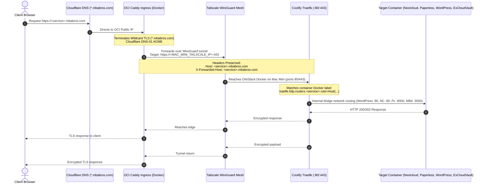
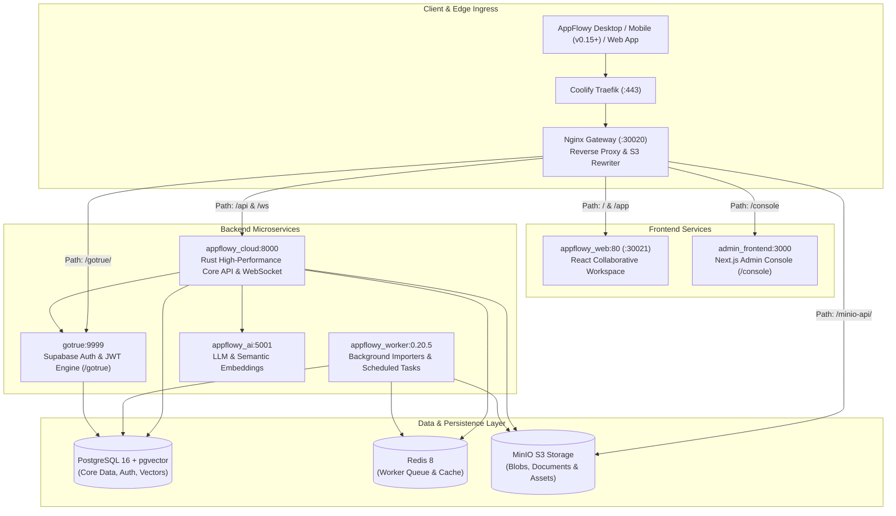
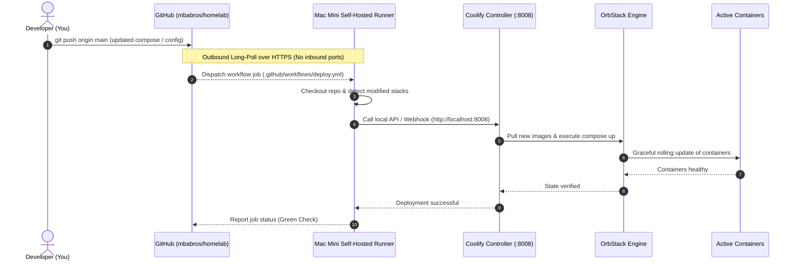

# Homelab System Architecture

This document details the architectural design, network topology, security model, and GitOps pipeline for the self-hosted homelab infrastructure.

---

## 1. High-Level Architecture Overview

The homelab is architected across a multi-node compute infrastructure: an **Edge Ingress Node** on Oracle Cloud Infrastructure (OCI Free Tier), a **Primary Homelab Node** on a local Apple Silicon Mac Mini, and a **Secondary Homelab Node (`wsl-docker-server`)** on a Windows host running native Docker within WSL2 (Ubuntu 26.04 LTS), all interconnected via an encrypted **Tailscale WireGuard Mesh VPN**.

```mermaid
flowchart TD
    subgraph Internet["Public Internet & External Services"]
        Users["Web Traffic (*.mbabros.com)"]
        GitHub["GitHub Cloud (mbabros/homelab)"]
        Vercel["Vercel Frontend (mbabros.com)"]
        ExVault["ExCloudVault Ingress (excloudvault.mbabros.com)"]
    end

    subgraph Edge["Edge Ingress: Oracle Cloud (OCI Free Tier VM)"]
        CF_DNS["Cloudflare DNS (DNS-01 ACME)"]
        Caddy["Caddy Reverse Proxy (Docker)"]
        Uptime["Uptime Kuma (:3001)"]
        Shlink["Shlink (:8080)"]
    end

    subgraph Mesh["Encrypted Tailscale Mesh VPN (WireGuard)"]
        TS_Tunnel["Point-to-Point Overlay Network"]
    end

    subgraph HomelabPrimary["Primary Homelab Node: Apple Mac Mini (macOS)"]
        subgraph Runtime["Runtime & CI/CD Layer"]
            Runner["GitHub Actions Self-Hosted Runner\n(Outbound Long-Poll, Zero Inbound Ports)"]
            OrbStack["OrbStack Docker Engine\n(High-Performance Linux Kernel Runtime)"]
            Coolify["Coolify PaaS Controller (:8008)\n(Laravel · PostgreSQL 15 · Redis 7)"]
            Traefik["Coolify Traefik Ingress (:80/:443)\n(coolify-proxy · Dynamic Host Routing)"]
        end

        subgraph Stacks["Container Application Stacks (Coolify Managed)"]
            WP["WordPress Stack\n(WordPress :8001 · MySQL 8.0)"]
            NC["Nextcloud Stack\n(Nextcloud :8080 · MariaDB 10.11 · Redis)"]
            PL["Paperless-ngx Stack\n(Paperless :8086 · Postgres 15 · Redis · Gotenberg · Tika)"]
            KK["Karakeep / Hoarder Stack\n(Web :30000 · Meilisearch · Chrome)"]
            JOP["Joplin Server Stack\n(Server :22300 · PostgreSQL 16)"]
            AF["AppFlowy Cloud Stack\n(Nginx :30020 · Rust API · GoTrue · MinIO)"]
            ECV["ExCloudVault Stack\n(Astro 5 + Starlight :30010 · Node.js API)"]
            Utils["Utilities Stack\n(Microbin :8888 · Dashy :4000 · Nexterm :6989)"]
        end

        subgraph Storage["Persistent Local Storage"]
            Vols["Docker Named Volumes\n(WordPress-config, nextcloud-*, paperless-*, karakeep_*)"]
            Binds["Host Directory Mounts\n(~/nextcloud-data, ~/paperless/*, ~/dashy)"]
        end
    end

    subgraph HomelabSecondary["Secondary Homelab Node: Windows Host (WSL2 Ubuntu Docker Server)"]
        subgraph WSLRuntime["WSL2 Runtime Layer (Ubuntu 26.04 LTS)"]
            WSLDocker["Docker Engine (Native Linux)\n(Mirrored Networking Mode)"]
            CoolifyWSL["Secondary Coolify Controller (:8000)\n(Isolated Management PaaS)"]
        end

        subgraph WSLStacks["WSL Container Application Stacks"]
            ImmichServer["Immich Server (:2283)\n(High-Performance Media Engine)"]
            ImmichML["Immich Machine Learning (:3003)\n(CLIP & Facial Recognition)"]
            ImmichDB["PostgreSQL (VectorChord)\n(pgvector · Vector Search)"]
            ImmichRedis["Redis Cache\n(Job Queues & Session Cache)"]
        end

        subgraph WSLStorage["High-Capacity Storage"]
            PhotoStorage["Photo Library Mount\n(Dedicated Media Volume)"]
            DBStorage["Database Mount\n(Persistent pgdata)"]
        end
    end

    Users --> CF_DNS
    CF_DNS -->|"mbabros.com (Apex CNAME)"| Vercel
    CF_DNS -->|"*.mbabros.com (Wildcard A)"| Caddy
    Caddy -->|"excloudvault.mbabros.com (:30010)"| Traefik
    Caddy --> Uptime
    Caddy --> Shlink
    Caddy ==>|"Encrypted Tailscale WireGuard (:443)"| TS_Tunnel
    TS_Tunnel ==>|"Primary Node Ingress (:443)"| Traefik
    TS_Tunnel ==>|"Immich Ingress (:2283)"| ImmichServer
    Traefik -->|"Host: www.mbabros.com (:8001)"| WP
    Traefik -->|"Host: nextcloud.mbabros.com (:8080)"| NC
    Traefik -->|"Host: paperless.mbabros.com (:8086)"| PL
    Traefik -->|"Host: excloudvault.mbabros.com (:30010)"| ECV
    Traefik -->|"Port :8888 / :4000 / :6989"| Utils
    Traefik -->|"Port :30000"| KK

    ImmichServer --- ImmichML
    ImmichServer --- ImmichDB
    ImmichServer --- ImmichRedis
    WSLStacks --- WSLStorage

    GitHub -.->|"Outbound-only WebSocket Poll"| Runner
    Runner -->|"Local socket / Coolify API"| Coolify
    Coolify -->|"Orchestrates"| OrbStack
    OrbStack --> Stacks
    Stacks --- Storage
```



---

## 2. Network & Traffic Topology

### Ingress Routing Path
1. **DNS Resolution**:
   - Apex domain (`mbabros.com`) is managed via Cloudflare CNAME flattening to Vercel (`c1947903554823f6.vercel-dns-017.com`), serving the previous MBA Bros consulting frontend.
   - Wildcard subdomains (`*.mbabros.com`) point to the OCI edge VM public IP (`<edge-public-ip>`).
2. **Edge Ingress (OCI VM)**:
   - Caddy handles automated TLS termination using Cloudflare DNS-01 challenges (`*.<domain>` wildcard certificate).
   - Traffic for `excloudvault.mbabros.com` is reverse-proxied across Tailscale WireGuard directly to the self-hosted Coolify container on the Mac Mini (:30010).
   - Local monitoring tools (Uptime Kuma, Shlink) terminate directly on the OCI VM.
3. **Tailscale Mesh Overlay**:
   - Traffic destined for homelab applications (`nextcloud`, `paperless`, `karakeep`, `microbin`, etc.) is proxied across the private Tailscale mesh directly to the Primary Node host ports or Coolify reverse proxy.
   - Traffic destined for media services (`immich.mbabros.com`, `photos.mbabros.com`) is proxied across Tailscale directly to the Secondary Node (`wsl-docker-server`) on port `2283`.
   - No public ports are opened directly on the home router (eliminating CGNAT/port-forwarding dependencies and DDoS exposure).

### Caddy to Coolify (Traefik) Ingress Architecture

Traffic flows through a multi-tier proxy architecture designed for zero open ports, DDoS mitigation, and dynamic Docker routing:



#### How the Caddy to Coolify Proxy Works

1. **Edge TLS Termination via Cloudflare DNS-01**:
   - Caddy on the OCI VM automatically provisions and renews a single wildcard certificate (`*.mbabros.com`) using the Cloudflare DNS API module.
   - Public clients negotiate TLS at the edge with Caddy; your local home IP and Tailscale IPs are never revealed.

2. **Tailscale WireGuard Transit**:
   - Instead of port forwarding on your home router, Caddy connects over the private Tailscale WireGuard overlay (`100.x.y.z`) to the Mac Mini.
   - All transit across the public internet between OCI and your Mac Mini is encrypted with WireGuard.

3. **Host Header Preservation & Wildcard Forwarding**:
   - In Caddy's configuration (`~/homelab-caddy-proxy/ansible/templates/Caddyfile.j2`), the catch-all wildcard block routes to the Mac Mini's port 443:
     ```caddy
     *.mbabros.com {
         import cloudflare_tls
         reverse_proxy https://<mac_mini_tailscale_ip>:443 {
             header_up Host {http.request.host}
             header_up X-Forwarded-Host {host}
             transport http {
                 tls_insecure_skip_verify
             }
         }
     }
     ```
   - Crucially, `header_up Host {http.request.host}` preserves the original requested hostname (`nextcloud.mbabros.com`, `www.mbabros.com`, etc.).

4. **Dynamic Host Routing via Traefik**:
   - Coolify runs Traefik (`coolify-proxy`) bound to ports 80 and 443 on the Mac Mini.
   - Traefik continuously reads the local Docker socket (`/var/run/docker.sock`) for container labels:
     ```yaml
     labels:
       - "traefik.enable=true"
       - "traefik.http.routers.nextcloud.rule=Host(`nextcloud.mbabros.com`)"
       - "traefik.http.routers.nextcloud.entrypoints=websecure"
     ```
   - When Caddy delivers a packet on port 443 with `Host: nextcloud.mbabros.com`, Traefik matches the router rule and dispatches the request directly to the `nextcloud` container on the internal bridge network.

5. **Cosmos to Coolify Cutover Mechanism**:
   - The production cutover was executed via `bash scripts/cutover.sh`: `cosmos-server` and `cosmos-mongo-msj` were gracefully stopped, and Coolify Traefik (`coolify-proxy`) bound host ports `80` and `443`.
   - Because Caddy's upstream target on OCI is `https://<mac_mini_tailscale_ip>:443` with `transport http { tls_insecure_skip_verify }`, **no changes to Caddy, DNS, Cloudflare, or OCI were required**. Caddy seamlessly routes all public domain traffic directly into Coolify Traefik over Tailscale.
   - Cosmos Cloud containers remain saved locally for instant rollback via `bash scripts/rollback.sh --restore-containers`.

### Service Port Map

| Domain / Host | Destination Node | Target Service | Local Port | Storage Mode | Coolify Status |
| :--- | :--- | :--- | :--- | :--- | :--- |
| `localhost:8008` | Mac Mini | Coolify Dashboard (Homelab) | `8008` | Bind `./coolify/data` | ✅ Active |
| `excloudvault.mbabros.com` | Mac Mini / Coolify | excloudvault-web | `30010:3000` | Ephemeral / Astro dist | ✅ Active |
| `mbabros.com` | Vercel Edge | Cloud Consulting | `443` | Vercel CDN | ✅ Active |
| Local / Tailscale | Mac Mini | Microbin | `8888:8080` | Volume `big-bear-microbin_data` | ✅ Migrated |
| Local / Tailscale | Mac Mini | Dashy Dashboard | `4000:8080` | Bind `~/dashy` | ✅ Migrated |
| Local / Tailscale | Mac Mini | Nexterm Web SSH | `127.0.0.1:6989:6989` (Tailscale Serve) | Volume `big-bear-nexterm-data` | ✅ Migrated |
| `www.mbabros.com` | Mac Mini | WordPress / Web | `8001:80` | Volume `WordPress-config` | ✅ Migrated |
| `nextcloud.mbabros.com`| Mac Mini | Nextcloud | `8080:80` | Bind `~/nextcloud-data` | ✅ Migrated |
| `paperless.mbabros.com`| Mac Mini | Paperless-ngx | `8086:8000` | Bind `~/paperless/*` | ✅ Migrated |
| `joplin.mbabros.com` | Mac Mini / Coolify | Joplin Server + Postgres | `22300:22300` | Volume `joplin-postgresql-data` | ✅ Active |
| `appflowy.mbabros.com` | Mac Mini / Coolify | AppFlowy Cloud Stack (Nginx Gateway) | `30020:80` | Volume `postgres-data`, `minio-data` | ✅ Active |
| `appflowy.mbabros.com/app` | Mac Mini / Coolify | AppFlowy Web App Client | `30021:80` | Container image | ✅ Active |
| Local / Tailscale | Mac Mini | Karakeep (Hoarder) | `30000:3000`| Volume `karakeep_data` | ✅ Migrated |
| `immich.mbabros.com` / `photos.mbabros.com` | WSL Node (`wsl-docker-server`) | Immich Server & Machine Learning | `2283:2283`, `3003` | Host Mounts (Photos & DB) | ✅ Active |
| Local / Tailscale | WSL Node (`wsl-docker-server`) | Coolify PaaS (Secondary Controller) | `8000:8080`, `6001`, `6002` | Volume `coolify-*-data` | ✅ Active |

### AppFlowy Cloud v0.20 Microservices Architecture

AppFlowy Cloud operates as a decoupled 10-container architecture managed under Coolify service UUID `nh7na8gkk8v7o5djlz2bwola`:



#### Core Architectural Requirements for AppFlowy Cloud
1. **Client Compatibility (Spaces Architecture)**:
   - AppFlowy mobile and desktop apps version 0.15.0+ require AppFlowy Cloud v0.20+.
   - Legacy 0.9.x backends return `404 Not Found` on `/api/workspace/{id}/view/{view_id}` and `/notifications/unread-count`, triggering `"You can't use that feature here"` in the client.
2. **S3 Presigned URLs & Host Header Rewriting**:
   - Web forms and file attachments use presigned MinIO URLs via `APPFLOWY_S3_PRESIGNED_URL_ENDPOINT=https://appflowy.mbabros.com/minio-api`.
   - Nginx strips the `/minio-api/` prefix and rewrites the `Host` header to `minio:9000` to satisfy MinIO's AWS Signature v4 requirements.
3. **Role-Based Access Control**:
   - Administrative features require `role = 'supabase_admin'` and `is_super_admin = true` in GoTrue's `auth.users` schema.
4. **Gmail SMTP Direct SSL**:
   - `appflowy_cloud` and `appflowy_worker` connect to Gmail SMTP via direct SSL on port 465 (`APPFLOWY_MAILER_SMTP_TLS_KIND=wrapper`).

---

## 3. GitOps & CI/CD Architecture

The deployment pipeline is built around **GitOps** principles using GitHub Actions and a **Self-Hosted Runner**:



### Why Self-Hosted Runner on Mac Mini?
- **Zero Inbound Attack Surface**: Traditional webhooks require exposing an HTTP endpoint on the internet. A self-hosted runner makes **outbound connections only** to GitHub via secure WebSockets (`wss://actions.githubusercontent.com`).
- **Cryptographic Scope Isolation**: The runner is registered exclusively to `mbabros/homelab` using a one-time registration token. Other repositories or internet users cannot schedule tasks on it.
- **Local Docker Socket Access**: Because the runner executes natively on macOS as the host user, it communicates with the local OrbStack Docker socket (`/var/run/docker.sock`) and Coolify API (`localhost:8008`) with zero network latency.

---

## 4. Security & Secrets Management Model

1. **Repository Sanitization**:
   - All production passwords, database root credentials, Redis secrets, and encryption keys are strictly omitted from version control.
   - Live secrets are stored locally in `~/homelab/.env` (enforced by `.gitignore`).
   - The repository tracks `.env.example` templates with empty placeholders for clean onboarding.
2. **Runtime Isolation**:
   - Coolify's internal state, SSH keys, and SQLite/Postgres databases reside in `~/homelab/coolify/data/`, which is completely excluded from git.
   - Containers run within isolated Docker bridge networks (`wordpress-net`, `nextcloud-net`, `paperless-net`, `karakeep-net`, `utilities-net`).
3. **Rollback Resilience**:
   - Legacy Cosmos Cloud containers (`cosmos-server`, `cosmos-mongo-msj`) remain present on disk in a stopped state.
   - If Coolify ever needs to be bypassed, executing `bash scripts/rollback.sh` restores Cosmos Cloud within 5 seconds without data loss.

---

## 5. macOS & OrbStack Compatibility Layer

Coolify is natively designed for Linux VPS environments running systemd, root SSH, and `/data/coolify` root filesystems. Running Coolify on macOS (Apple Silicon) with OrbStack required three architectural adaptations:

1. **APFS Read-Only Root & Base Configuration Path**:
   - Modern macOS enforces System Integrity Protection (SIP) and a Sealed System Volume where `/` is read-only.
   - Coolify was patched to make `base_configuration_dir()` configurable via the `BASE_CONFIG_PATH` environment variable.
   - Set to `BASE_CONFIG_PATH=$HOME/homelab/coolify/data`, enabling Coolify to read, write, and mount service compose files directly on the host without root filesystem restrictions.

2. **Non-Root User Sudo Bypass**:
   - Coolify defaults to prepending `sudo` to all remote commands when connecting as a non-root user.
   - On macOS with OrbStack, the host user owns the Docker socket (`/var/run/docker.sock`) and does not require or use `sudo`.
   - Patched `Server::isNonRoot()` in `coolify/Dockerfile` so that connections to `host.docker.internal` execute directly without `sudo`.

3. **Non-Interactive SSH PATH Resolution**:
   - When SSH commands run non-interactively, macOS `sshd` does not source `~/.zshrc`.
   - Created `~/.zshenv` exporting `/usr/local/bin:/opt/homebrew/bin:$HOME/.orbstack/bin` so Coolify has immediate access to `docker`, `docker-compose`, `git`, `curl`, and `jq`.

---

## 6. Secondary Node Architecture: Windows Host & WSL2 Docker Server (wsl-docker-server)

To offload high-throughput media ingest, machine learning vectorization, and intensive photo backups from the primary macOS node, a dedicated secondary compute node is deployed on a Windows host using a containerized **WSL2 Ubuntu 26.04 LTS (Resolute Raccoon)** environment.

### 1. WSL2 Mirrored Networking Topology
Traditional WSL2 virtual machines operate behind a hypervisor NAT bridge, necessitating brittle Windows port proxies (`netsh interface portproxy`) and dynamic IP routing. The secondary node leverages modern WSL2 **Mirrored Networking Mode** (`networkingMode=mirrored`):

```ini
# %USERPROFILE%\.wslconfig
[wsl2]
vmIdleTimeout=-1
networkingMode=mirrored
dnsTunneling=true

[general]
instanceIdleTimeout=-1
```

- **Zero-NAT Port Binding**: Any port opened inside the WSL2 Docker environment (such as Immich on `:2283` or SSH on `:2222`) is bound directly and natively to the host interfaces, including the Tailscale WireGuard virtual adapter.
- **Native Tailscale Addressing**: The edge reverse proxy (OCI Caddy) and management clients communicate directly with WSL containers over Tailscale without intermediate host-to-VM port forwarding.

### 2. Immich High-Performance Media Stack
Immich operates as a four-container microservices architecture optimized for rapid photo/video backup, vector search, and face clustering:

| Container Service | Image / Engine | Purpose & Routing |
| :--- | :--- | :--- |
| **`immich-server`** | `ghcr.io/immich-app/immich-server:v3.3.x` | Core REST API, multipart chunked media ingestion, WebSockets, background microservices (`:2283`) |
| **`immich-machine-learning`**| `ghcr.io/immich-app/immich-machine-learning:v3.3.x` | Python inference engine for CLIP visual embeddings and facial recognition (`:3003`) |
| **`immich-postgres`** | `ghcr.io/immich-app/postgres:14-vectorchord` | PostgreSQL database with `pgvector` and `vectorchord` extensions for instant similarity search |
| **`immich-redis`** | `redis:6.2.20-alpine` | BullMQ distributed job queues, thumbnail caching, and transcode queue management |

- **Storage Layout**: Media uploads reside on high-capacity host-attached storage mounted at `/usr/src/app/upload`. Database states persist in dedicated host binds for rapid backup and snapshotting.
- **Reverse Proxy Ingress**: Public HTTPS traffic to `immich.mbabros.com` and `photos.mbabros.com` is terminated at the edge by Caddy with Cloudflare wildcard TLS and reverse-proxied over the Tailscale mesh to `:2283` with streaming upload and WebSocket support.

### 3. Secondary Coolify PaaS Controller
To provide unified container lifecycle management and health monitoring without coupling the secondary node to the primary node's Docker socket, an independent, lightweight **Coolify** instance runs natively inside WSL2:
- **Services**: `coolify` core, `coolify-db` (PostgreSQL 15), and `coolify-redis` (Redis 7).
- **Interface**: Exposed on local/mesh port `8000` (mapped from container `:8080`) with real-time WebSocket event streaming on `:6001` and interactive terminal proxying on `:6002`.

### 4. Administrative Security & Direct SSH Isolation
- **Direct WSL Terminal Ingress**: The Linux OpenSSH daemon inside WSL is configured on port `2222` (`/etc/ssh/sshd_config.d/wsl.conf`).
- **Bypassing Host PowerShell**: Connecting to port `22` lands in Windows OpenSSH / PowerShell; connecting to port `2222` lands directly in the native Ubuntu `bash` shell with full Linux PTY allocation.
- **Public-Key-Only Authentication**: Password authentication is disabled (`PasswordAuthentication no`) and account passwords are locked, enforcing cryptographic public-key authentication for all management sessions.

---

## 7. Observability & Unified Telegram Alerting

Both the edge monitoring system (**Uptime Kuma** on OCI) and the local control plane (**Coolify** on Mac Mini) are integrated into a single Telegram bot for alerts:

| Channel / Service | Trigger Conditions | Destination |
| :--- | :--- | :--- |
| **Uptime Kuma** (Edge) | External endpoint health check failures, latency spikes, TLS expiration | Dedicated Telegram Alert Chat |
| **Coolify** (Homelab) | Deployment success/failure, container crash/restart limit, disk usage warnings, backup status | Dedicated Telegram Alert Chat |

- **Security & Privacy**: Telegram Bot tokens and chat IDs are stored encrypted at rest within Coolify's PostgreSQL database (`telegram_notification_settings` table using Laravel's `encrypted` model casting) and omitted from version control.
- **Actionable Buttons**: Coolify notifications include inline keyboard links pointing to your management dashboard for rapid triage.
